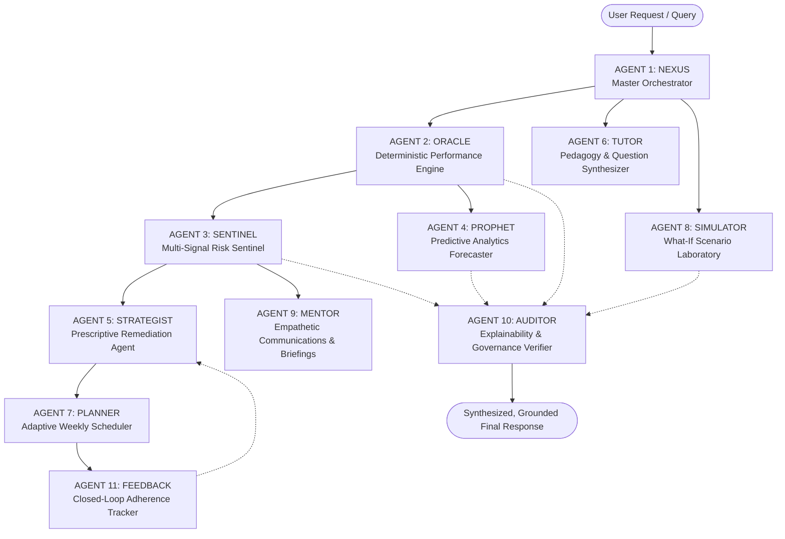

# EduPilot AI — Autonomous Academic Intelligence & Student Success Platform


[](https://github.com/17shravani/Academic-Progress-Tracker)
[](https://github.com/17shravani/Academic-Progress-Tracker)
[](https://github.com/17shravani/Academic-Progress-Tracker)
[](https://github.com/17shravani/Academic-Progress-Tracker)

**EduPilot AI** is an autonomous academic intelligence platform engineered for higher-education institutions, academic advisors, faculty, and students. Moving beyond passive marks-tracking dashboards, EduPilot transforms raw continuous evaluations, lab records, and attendance logs into **verifiable early warnings, personalized 7-day study blueprints, deterministic what-if scenario simulations, and closed-loop faculty interventions** through a coordinated 11-agent autonomous ecosystem.

---

## 🌟 Architecture: 11-Agent Autonomous Ecosystem

EduPilot operates a modular multi-agent workflow where deterministic numerical verification is strictly separated from probabilistic regression and natural language reasoning.



### Specialized Agent Responsibilities

| Agent Name | Architectural Classification | Core Responsibilities |
| :--- | :--- | :--- |
| **NEXUS** | Orchestrator & Task Classifier | Parses natural-language intents, manages execution DAG, traces reasoning steps, and synthesizes grounded outputs. |
| **ORACLE** | Deterministic Mathematical Engine | Authoritatively computes semester SGPAs, cumulative CGPAs, credit-weighted averages, and assessment trend velocity slopes without generative hallucination. |
| **SENTINEL** | Rule-Based Early Warning | Evaluates multi-factor threshold rules: Attendance debarment risk (<75%), negative score velocity (>6% drop), missing assessments, and outputs severity-ranked alerts with measured evidence. |
| **PROPHET** | Predictive ML Forecaster | Forecasts end-semester SGPA trajectories with **95% Confidence Intervals** using a calibrated Ridge + Gradient Boosting ensemble (MAE: 0.29, R²: 0.884) and generates feature importance attribution. |
| **STRATEGIST** | Prescriptive Optimizer | Analyzes identified curriculum learning gaps, evaluates student available hours, and formulates high-yield remedial priorities. |
| **TUTOR** | Pedagogical Explainer | Provides 5-step problem solving frameworks, syllabus-grounded concept breakdowns, misconception shields, and interactive diagnostic quizzes with real-time verification. |
| **PLANNER** | Algorithmic Scheduler | Converts learning prescriptions into an actionable 7-day balanced timetable respecting available study hours and upcoming deadlines. |
| **SIMULATOR** | Scenario Modeling Lab | Computes exact mathematical impact of hypothetical exam scores, study hour increases, and attendance recovery rates with live formula transparency. |
| **MENTOR** | Empathetic Communication Liaison | Drafts supportive, growth-mindset check-in messages for students (anti-shaming compliant) and structured advisory briefings for faculty mentors. |
| **AUDITOR** | Governance & Policy Sentinel | Verifies every numeric claim against recorded SIS ground truth, enforces FERPA/privacy role access, and flags ungrounded conclusions. |
| **FEEDBACK** | Closed-Loop Evaluation Tracker | Measures student completion rates of assigned study tasks, computes intervention efficacy, and feeds back into adaptive strategy re-planning. |

---

## 🖥️ Four Specialized Enterprise Workspaces

### 1. 🎓 Student Intelligence Workspace
- **Academic Scorecard & Trajectory**: Real-time calculated SGPA, predicted final SGPA with confidence bounds, attendance compliance indicator, and active risk count.
- **Course Mastery & Diagnostic Gap Matrix**: Granular breakdown of continuous internal evaluations (CIEs), lab practicals, score velocity trends, and identified topic-level gaps.
- **Sentinel Early-Warning Feed**: Actionable alert cards with collapsible measured evidence and direct 1-click remediation triggers.
- **What-If Academic Simulation Lab**: Interactive sliders for hypothetical exam scores, additional weekly study hours, attendance recovery, and assignment completion rates.
- **AI Adaptive Study Planner**: 7-day interactive timetable with checkbox completion logging, celebratory confetti animations, and real-time adherence updates.
- **Autonomous Tutor & Practice Hub**: Step-by-step concept frameworks and multiple-choice diagnostic practice questions with instant verification and explanations.
- **AI Academic Copilot**: Context-aware natural-language assistant featuring an expandable **Multi-Agent Execution Trace** displaying sub-agent latency, determinism, and audit verification status.

### 2. 👩‍🏫 Faculty & Mentor Command Center
- **Cohort Early-Warning Triage**: Categorizes student populations into *Critical Risk*, *Moderate Watchlist*, and *On-Track / Exemplary*.
- **Student Roster Inspection**: Searchable and filterable student roster with direct inspection links.
- **Intervention Dispatch Modal**: 1-click workflow to schedule 1-on-1 counseling, select remediation type, and dispatch MENTOR agent supportive outreach drafts.
- **Interventions History Log**: Comprehensive audit trail of scheduled meetings, faculty notes, and resolution statuses.

### 3. 🏛️ Academic Administrator Dashboard
- **Institutional Analytics**: Retention risk percentages, cohort-wide GPA metrics, and Outcome-Based Education (OBE) course outcome attainment indicators.
- **Department Benchmarks**: Comparative analysis across departments (Computer Science, Information Science, Electronics, Mechanical).
- **Course Failure Probability**: Identifies high-risk courses and attendance vulnerabilities across cohorts.
- **Academic Data Ingestion Pipeline**: Live CSV/JSON import tool with real-time schema validation, bounds checking [0-100], and dynamic student record ingestion.

### 4. 🤖 AI Agent Operations & Telemetry Center
- **Live Multi-Agent Graph**: Interactive visualizer showing all 11 agents, active status, message paths, and determinism tags.
- **Execution Audit Trail**: Granular log of every agent execution step, latency (ms), input/output summaries, and confidence scores.
- **Model Card & Ethical Transparency**: Algorithm specifications, MAE/R² evaluation metrics, training provenance, and anti-shaming guardrails.

### 5. 📄 Downloadable Academic Intelligence Report
- Formal, institutional-grade document generator with print-to-PDF formatting and CSV data export.

---

## 🚀 Quick Start Guide

### Prerequisites
- **Node.js** v18+ or v20+ / v22+
- **npm** v9+ or v10+

### Installation & Local Launch

```bash
# 1. Clone repository
git clone https://github.com/17shravani/Academic-Progress-Tracker.git
cd Academic-Progress-Tracker

# 2. Install dependencies
npm install

# 3. Start local development server
npm run dev
```

Open your browser at `http://localhost:5173` to explore EduPilot AI!

### Production Build

```bash
# Compile and create optimized production bundle
npm run build

# Preview production build locally
npm run preview
```

---

## 🔒 Responsible AI & Ethical Guardrails

- **Zero Generative Hallucination for Grades**: All GPA, marks, attendance, and credit math are strictly computed by deterministic algorithms (ORACLE Agent).
- **Anti-Shaming & Growth Mindset**: All student communications generated by the MENTOR agent are constrained to constructive, diagnostic language that frames setbacks as strategy-adjustment opportunities.
- **FERPA & Privacy Protection**: Role-based access ensures confidential student advisories are accessible only to authorized mentors and faculty.
- **Separation of Fact vs. Hypothesis**: The system explicitly marks measured data, statistical forecasts (with confidence intervals), and hypothetical what-if simulations with distinct UI visual treatments.

---

## 🛠️ Tech Stack

- **Frontend Core**: React 19, TypeScript, Vite
- **Styling**: Vanilla Cyber-Academic Design System with custom HSL tokens, glassmorphism, responsive grid layout, and dark/light mode toggle
- **Icons**: Lucide React
- **Micro-Interactions**: Canvas Confetti
- **Orchestration**: Custom Multi-Agent Execution Pipeline with Typed Interfaces

---

## 👥 Authors & License

Developed for **Academic Progress Tracker / EduPilot AI**. Distributed under the MIT License.
